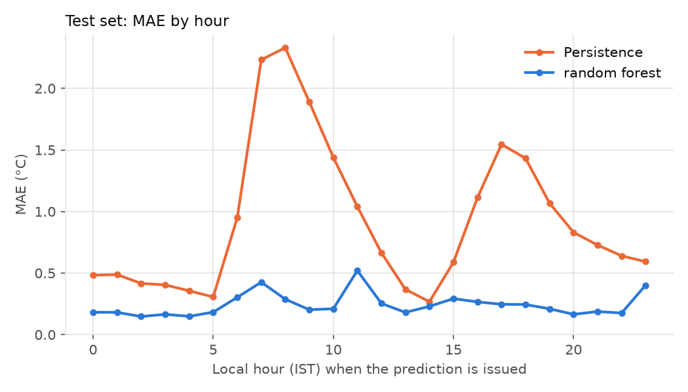
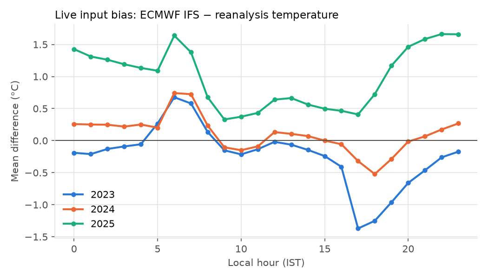
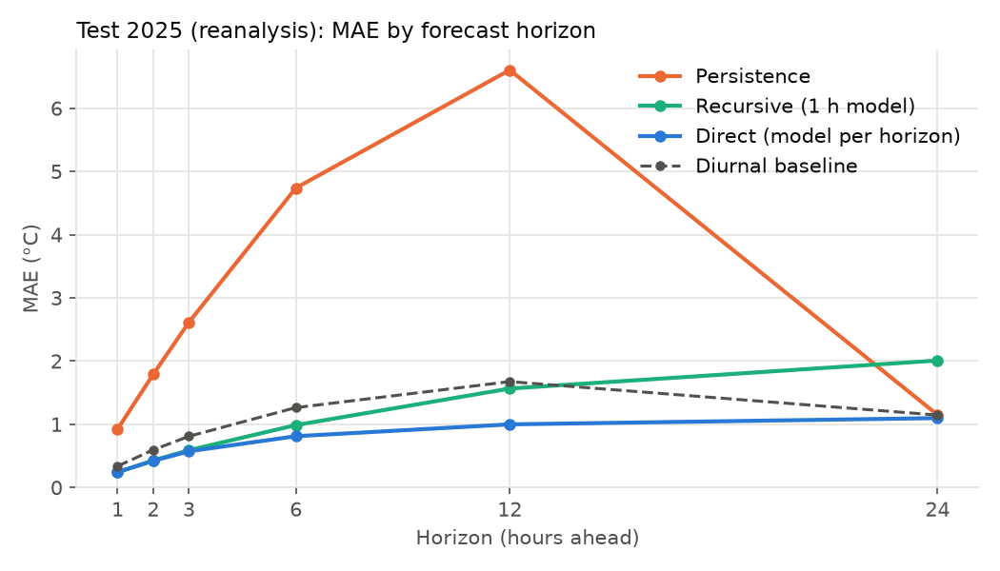

# Cloudzy ☁️ — Weather with a little intelligence

Cloudzy is a weather app backed by **Cloudzy Core**, a machine-learning forecasting
engine evaluated against honest baselines. This repository is built engine-first:
the UI comes only after the ML pipeline works and has been measured.

[](https://github.com/WillBettleheim/Cloudzy/actions/workflows/tests.yml)

> ⚠️ **Experimental student project.** Cloudzy Core's predictions are not an
> operational weather forecast. For decisions, use the provider forecast shown
> beside them, or your national weather service.

> **Status: Cloudzy 2.0, running locally.** It works end to end on this machine, but
> it is not deployed and not production-ready. Real forecasts and history work for
> any place. Cloudzy's own ML predictions cover Delhi only. See the
> [architecture](docs/ARCHITECTURE.md), the [model card](MODEL_CARD.md) and the
> [deployment guide](DEPLOYMENT.md).
> - **Research setting** (reanalysis in, reanalysis out): MAE is **0.242 °C** one
>   hour ahead on the untouched 2025 test year. Persistence scores 0.924 °C and a
>   climatological diurnal baseline 0.337 °C.
> - **Live setting** (the deployed 2 MB models, fed ECMWF IFS forecasts as the
>   live app is): MAE is **1.12 °C** one hour ahead and **1.34 °C** 24 hours
>   ahead. These come from a 2025 replay of *archived* IFS forecasts, a best case
>   for real-time inputs. The bottleneck is the disagreement between the two data
>   sources, not the model.
> - **Live accuracy is still pending.** The app records every live prediction
>   (Predictions page) and checks it once the reanalysis for its target hour is
>   published, about 6 days later. Until enough have been checked, there is no
>   measured live accuracy, and the app says so instead of showing a number.
>
> All errors are measured against **reanalysis data, not a thermometer**.

## What Cloudzy does

| Area | Features |
|---|---|
| **Your location** | "Use my location": a one-time browser location lookup with permission. The weather is fetched for the exact coordinates, and the place name comes from OpenStreetMap. Clear messages for every failure; manual search is always available |
| **Weather app** | City search with a match picker (same-name places kept apart by coordinates); current conditions; next 24 hours (cards and graph); 7-day forecast; detail cards (UV, humidity and dew point, wind, feels-like, rain, clouds, pressure, visibility, sun) |
| **Settings** (`/settings`) | °C/°F, km/h, m/s, mph or knots, mm/in (regional by default); detect location on start; brief or detailed summary; theme guidance; reset. Saved in each visitor's own browser, so people sharing one Cloudzy server never see or change each other's settings; never synced between devices, never precise device coordinates |
| **Places** (`/places`) | Saved cities as cards: open one on the Weather page, make it your home city (opens first), or remove it |
| **Alerts** (`/alerts`) | Active and dismissed alerts for the place you're viewing (with each dismissal's expiry and "show again"), alert categories, thresholds and optional browser notifications. Clearly labelled as unofficial |
| **Weather Explorer** (`/explorer`) | 3D globe (NASA Earth imagery with real day and night) and a flat map of NOAA GFS forecast fields, with search fly-to and fullscreen (1° grid, 3-hourly to +72 h): wind particles driven by the real vectors, temperature, precipitation with rain/snow/mixed type, cloud cover, pressure with isobars, gusts, humidity, CAPE, snow depth, GFS-Wave wave height; forecast timeline with playback; click for grid values and a separate point forecast |
| **Design** | "Atmospheric Intelligence": an immersive current-weather sky that follows the real weather code and local sun times (clear day/night, dawn, dusk, partly cloudy, overcast, fog, rain, storm, snow; decorative, static under reduced motion), Inter and Outfit type with tabular figures, editorial page headers, hairline instrument readouts instead of boxed tiles, weather-aware saved-place cards, sidebar navigation, Material Symbols icons, and layouts checked at phone, tablet and laptop widths |
| **Weather intelligence** | "Cloudzy says" summary (temperature trend, earlier today, rain timing, wind, clouds, tomorrow; nothing when data is missing or more than 3 h old), unofficial alerts (reason, value, period, uncertainty; dismissable; at most one per kind per day), daily briefing, suggestions with reasons. Rule-based, built from the forecast numbers, with no language model |
| **Cloudzy Core** | Experimental 1–24 h temperature model for Delhi, kept separate from the provider forecast; refuses to predict on incomplete inputs |
| **Predictions** (`/predictions`) | Every live Cloudzy Core prediction, recorded once (SQLite, local) with its model version, then evaluated against the reanalysis at the exact target hour once it's published; filters, tracked MAE/RMSE/bias by horizon with sample counts, CSV export |
| **History** (`/history`) | Past weather anywhere since 1940 (reanalysis): daily charts and tables, monthly summaries, and a comparison with the same dates in the previous 5–30 years |
| **Cloudzy Lab** (`/lab`) | Deployed model version, scoreboard against baselines, predictions vs. observed, error breakdowns, live setting, multi-step, explainability, live tracking summary, plain-language explainers, limitations. Every chart has its numbers in a table |

Data comes from Open-Meteo (free, non-commercial, CC BY 4.0). No API keys or
accounts are needed.

## Quick start (macOS, Apple Silicon)

```bash
git clone https://github.com/WillBettleheim/Cloudzy.git
cd Cloudzy
python3.13 -m venv .venv
source .venv/bin/activate
pip install -r requirements.txt

streamlit run streamlit_app.py   # the app: weather at http://localhost:8501, Cloudzy Lab at /lab
python -m pytest                 # 498 offline tests, no network needed
python -m src.pipeline all       # Cloudzy Core: fetch → train → evaluate (Delhi, 2023-2025, ~30 s when cached)
python -m pytest -m integration   # 5 live checks against the Open-Meteo APIs
python -m src.data_validation    # download (first run only), validate, write processed CSV
python -m src.features           # build the feature table
python -m src.train              # tune on 2024, test on 2025, save model and report (~1 min)

# Phase B
python -m src.data_validation --source ecmwf_ifs   # archived live-model inputs, 2023-2025
python -m src.shift              # distribution shift study (~15 s)
python -m src.multistep          # direct vs recursive, horizons 1-24 h; saves the serving bundle (~1 min)
python -m src.service            # live forecast for Delhi right now (needs internet)
python -m src.refit              # monthly: refit serving models on data to the latest complete month

# Phase C
python -m src.provider "Reykjavik"   # Open-Meteo forecast for any place
python -m src.briefing "New Delhi"   # provider forecast + rain outlook + Cloudzy (Delhi only)

# Phase D and E
streamlit run streamlit_app.py       # weather app at http://localhost:8501, Cloudzy Lab at /lab
python -m src.lab_data               # rebuild the Lab's data after re-running the experiments (~15 s)

# Phase F
python -m src.compact                # size-constrained serving models → the deployed 2 MB bundle (~1 min)

# Cloudzy 2.0
python -m src.monitoring             # evaluate tracked live predictions once the reanalysis is out (~6 days later)
```

Only the first block is needed to run the app: the deployed model and the Lab
data are committed. The other commands reproduce the experiments.

The data step downloads three yearly files on its first run (about 1 s each).
Later runs log `Cached: ... (skipping download)` and make no API calls.

To reproduce the ERA5 comparison run, prefix any command with
`CLOUDZY_WEATHER_MODEL=era5`. Every output file name includes the data source,
so the two runs never overwrite each other.

## Stage 1: data pipeline

| Layer | Location | Contents |
|---|---|---|
| Raw | `data/raw/<city>_<model>_<start>_<end>_<hash>.json` | Untouched API response, request parameters, retrieval timestamp |
| Processed | `data/processed/delhi_hourly_<model>_2023-01-01_2025-12-31.csv` | Validated hourly table, UTC timestamps, `is_gap_fill` flag |
| Report | `reports/data_quality_delhi_<model>.json` | Every check result, counts of every fix, summary stats, source metadata |

### Data decisions (and why)

- **Source: Open-Meteo Historical Weather API, `models=era5_seamless`.** This
  takes temperature and humidity from **ERA5-Land** (~9 km grid) and pressure,
  wind and precipitation from **ERA5** (~25 km). The combination is the same
  for the whole period. Both are ECMWF reanalyses: they blend observations with
  a physics model.
- **Why not plain ERA5 (the first choice)?** At this location, ERA5's hourly
  temperature moves in uneven steps at fixed UTC hours. For example, the mean
  hour-to-hour change is 3.2 °C into 05 UTC but 0.5 °C into 07 UTC, and a real
  thermometer doesn't behave like that. Measured as the mean absolute second
  difference over 2023–2025, ERA5 is 1.00 °C and ERA5-Land is 0.52 °C.
- **Why not plain ERA5-Land?** Through Open-Meteo, it returns *no values at all*
  for pressure, wind and precipitation. Validation now treats an all-missing
  variable as fatal. The first version only counted the missing values, which
  was a gap.
- **How the switch was decided.** The switch was based on the smoothness check
  above, not on model scores. ERA5 results are kept and reported below as a
  comparison.
- **What "observed" means here.** It means the reanalysis value for the grid
  cell at 28.60 N, 77.20 E (elevation 214 m), which the API snapped from the
  requested 28.61 N, 77.21 E. Results describe how well we predict that
  reanalysis, not a specific weather station.
- **Period: 2023-01-01 to 2025-12-31, UTC.** This is three full calendar years
  (26,304 hours), with fixed dates. Each year is requested and cached separately.
- **No imputation in the data layer.** Missing hours become NaN rows marked with
  `is_gap_fill`. Implausible values become NaN and are counted in the report.

### What validation checks

| Category | Checks |
|---|---|
| Fatal (pipeline stops) | Missing columns, unexpected units, non-UTC offset, unparseable or off-the-hour timestamps, duplicate timestamps whose values disagree, data from different grid cells, empty data, a variable with no values at all |
| Fixed and counted | Exact duplicate rows, unsorted rows, missing hours, non-numeric values, physically implausible values |
| Flagged but kept | Hour-to-hour temperature changes larger than 8 °C; any variable more than 5% missing |

**Result (`era5_seamless`):** 26,304 rows. There are no missing hours,
duplicates, missing values, out-of-range values or flagged jumps. Temperature
ranges from 2.7 to 45.6 °C, with a mean of 24.4 °C. The ERA5 run also came out
clean. It had one flagged jump, −9.9 °C at 14→15 UTC on 2025-05-21, when wind
rose from 12 to 30 km/h at the same time, which fits a thunderstorm outflow.

## Stage 2: features and target

For each hour *t* (the time a prediction is issued), the target is the 2 m
temperature at *t + 1 h*. Every feature uses only values at times ≤ *t*.

| Group | Features |
|---|---|
| Current temperature | `temperature_2m` at *t* (also the persistence forecast) |
| Lags | temperature at *t − 1, 2, 3, 6, 12, 24 h* |
| Changes | 1 h and 24 h temperature change |
| Rolling stats | mean and std over 3, 6 and 24 h; min and max over 24 h (windows end at *t*) |
| Other variables at *t* | humidity, surface pressure, wind speed, precipitation |
| Derived | 3 h pressure change, 3 h precipitation total |
| Calendar | hour of day (IST) and day of year, each as sin/cos |

That is 27 features in total. `feature_columns()` in `src/features.py` defines
their exact order, and every saved model stores it.

**How leakage is prevented and tested.**
- Lags and windows use `shift` and right-aligned `rolling` on a complete hourly
  grid. `build_features` refuses any index that is not a sorted, unique, hourly
  UTC grid, because on an irregular index a shift would silently misalign.
- A perturbation test replaces every value after *t* with random numbers,
  rebuilds the features, and requires everything at or before *t* to be
  unchanged.
- Synthetic ramp data (temperature = hour number) checks that each lag is
  exactly *k* hours back, and that the target is exactly one hour ahead.
- Rows touching a gap are dropped, never imputed. A test checks that exactly
  the affected rows disappear.
- The split purges boundary rows whose target lies in the next period (see
  Stage 3). Scaling sits inside the scikit-learn pipeline, so it is fitted on
  training rows only.

The table has 26,279 rows: 26,304 minus 24 warm-up hours, minus the final hour,
which has no target.

## Stage 3: models and evaluation

### Protocol

| Split | Issue times (UTC) | Rows | Used for |
|---|---|---|---|
| Train | 2023-01-02 00:00 → 2023-12-31 22:00 | 8,735 | Fitting candidates |
| Validation | 2024-01-01 00:00 → 2024-12-31 22:00 | 8,783 | Choosing hyperparameters and the final model |
| Test | 2025-01-01 00:00 → 2025-12-31 22:00 | 8,759 | One final score per model, no decisions |

- **Each split is a full year,** so all three cover every season. With a split
  such as "validate on autumn, test on winter", you couldn't tell season effects
  from model effects.
- **Boundary purge:** the last hour of each split is dropped, because its target
  is the first hour of the next split.
- **Selection is by validation MAE only.** Each model family's best
  configuration is then refitted on train + validation (17,518 rows) and scored
  once on 2025.
- **Models:**
  - Persistence.
  - A **climatological diurnal baseline**: the current temperature plus the
    average 1-hour change at that local hour and time of year, learned from
    training data.
  - Linear regression.
  - Random forest.
  - Gradient boosting (`HistGradientBoostingRegressor`). Its built-in early
    stopping is disabled because it holds out a *random* subset of rows.
- **Residual target:** tree models can learn *y − temperature(t)* instead of *y*.
  This is a tuned hyperparameter, and it won for both tree families.
- **Fixed seed:** 42 everywhere.

### Results on the untouched 2025 test year (`era5_seamless`)

| Model | MAE °C | RMSE °C | Bias °C | 90th pct abs error °C | Max abs error °C |
|---|---|---|---|---|---|
| Persistence | 0.924 | 1.263 | 0.000 | 2.10 | 6.40 |
| Diurnal baseline | 0.337 | 0.523 | −0.001 | 0.77 | 5.79 |
| Linear regression | 0.381 | 0.568 | +0.001 | 0.85 | 6.05 |
| **Random forest (selected)** | **0.242** | 0.410 | +0.005 | 0.54 | 6.03 |
| Gradient boosting | 0.248 | 0.408 | +0.004 | 0.56 | 5.95 |

Selected configuration: random forest, residual target, `max_depth=12`,
`min_samples_leaf=5`, 200 trees, `max_features=0.5`. Its validation MAE was
0.251 °C.

**Does it beat the baselines? Yes.** The intervals below are 95% bootstrap
intervals that resample whole weeks, because hourly errors are autocorrelated
and resampling single hours would give falsely narrow intervals.
- **Against persistence:** MAE is 0.682 °C lower, interval [0.598, 0.760]. That
  is 74% lower.
- **Against the diurnal baseline:** MAE is 0.095 °C lower, interval
  [0.079, 0.114]. That is 28% lower.

The second comparison is the honest one. Most of the gain over persistence comes
from simply knowing the typical daily heating and cooling. The model's
additional skill is real but much smaller.

**Where errors occur:**
- **Persistence** fails during morning heating (MAE above 2 °C at 07 and 08 IST)
  and evening cooling (about 1.5 °C at 17–18 IST).
- **The random forest** stays between 0.15 and 0.52 °C at every hour.
- **By season,** the model's MAE is 0.22 °C in winter, 0.28 °C pre-monsoon,
  0.23 °C during the monsoon and 0.24 °C post-monsoon. It is highest in May
  (0.32 °C), when pre-monsoon storms are common.
- **The largest errors (up to about 6 °C)** happen in sudden events, such as
  storm outflows, that no model of this kind can anticipate.

**What didn't work:**
- **Linear regression is worse than the diurnal baseline.** It can only add one
  sin/cos curve to the current temperature, but the typical hourly change
  depends on hour and season *together*. Trees can model that interaction.
- **Deeper gradient boosting overfit:** 800 iterations scored worse than 300 on
  validation.

Figures are in `reports/figures/delhi_era5_seamless/`:



### Comparison run on plain ERA5

| Model | Test MAE °C |
|---|---|
| Persistence | 0.900 |
| Diurnal baseline | 0.410 |
| Linear regression | 0.639 |
| **Random forest (selected)** | **0.346** |
| Gradient boosting | 0.355 |

On ERA5, the selected random forest beats the diurnal baseline by 0.064 °C, with
a 95% interval of [0.052, 0.078]. I suspected ERA5's uneven hourly steps might
*inflate* the model's apparent skill. The comparison shows the opposite: the
steps make ERA5 *harder* to predict. So the reason for switching sources is
realism, not better scores.

### Limitations

- **Reanalysis targets, not station observations.** Errors against a real
  thermometer would be larger. A single grid cell also smooths out city-scale
  effects such as the urban heat island.
- **"Available at time t" is idealised.** ERA5 data is published about five days
  late. A live service needs a real-time source of current conditions, and
  switching sources is a distribution shift that must be measured (Phase B/C).
- **One location, one horizon, one test year.** The results don't carry over to
  other cities or to longer lead times without new experiments.
- **Point predictions only.** There are no probabilities or confidence
  intervals. The bootstrap intervals above describe uncertainty in the *MAE
  comparison*, not in individual forecasts.

**Nowcasting vs. forecasting.** Predicting one hour ahead from recent values is
mostly about persistence plus the daily cycle. Forecasting many hours or days
ahead is a different problem. Uncertainty compounds over time, and recent local
values carry less information. Operational forecasts handle long horizons with
physical models of the whole atmosphere. Cloudzy's 1-hour model doesn't replace
a meteorological forecast. Multi-step prediction will need its own strategy and
its own evaluation.

**Observed vs. forecast-provider features.** All 27 features are
observation-type. A provider's forecast for *t + 1* would be a different kind of
input, so it is reserved for a separate, clearly labelled experiment.

## Phase B: forecast service, distribution shift and multi-step

### Where live inputs come from

At run time Cloudzy can't get reanalysis data, which is published about five
days late. It uses **ECMWF IFS** output from the Open-Meteo Forecast API
(`models=ecmwf_ifs`). The default `best_match` uses the same grid cell for Delhi,
but it is pinned here because `best_match` can change its underlying model
without notice. The 15-minute "current" value is model-derived as well.

**Replaying live inputs for 2023–2025.** Open-Meteo's Historical Forecast API
archives what the Forecast API serves. I checked this directly: for 144 hours
(2026-10-14 to 2026-10-19), the live past hours and the archive were identical
for all five variables.

**This replay is a best case.** The archive keeps, for each hour, the value from
the newest model run covering it. A system running at time *t* only has runs
already published, which arrive hours late, so its newest inputs are
longer-lead forecasts. The service saves every live response to
`data/live_snapshots/` so this gap can be measured over time. For the same
reason, the archived IFS value *for t+h* is never used as a feature: it may come
from a run started after *t*.

### Distribution shift: IFS vs. reanalysis (`python -m src.shift`)

Hour-by-hour differences between the two sources (IFS − reanalysis), 2023–2025:

| Variable | Bias, all years | MAE | Correlation | Bias, 2023 / 2024 / 2025 |
|---|---|---|---|---|
| Temperature (°C) | +0.29 | 1.13 | 0.982 | −0.23 / +0.10 / **+0.99** |
| Relative humidity (%) | −2.2 | 6.1 | 0.943 | +0.2 / −2.1 / −4.7 |
| Surface pressure (hPa) | +0.12 | 0.37 | 0.998 | stable |
| Wind speed (km/h) | −0.36 | 2.53 | 0.713 | +0.9 / +0.3 / −2.3 |
| Precipitation (mm) | +0.01 | 0.14 | 0.242 | rain timing rarely agrees hour by hour |

Three things stand out:
- **The sources disagree by 1.13 °C** hour by hour. That is more than
  persistence's entire 1-hour error on reanalysis.
- **The IFS source drifts.** The temperature bias jumped in 2025, and IFS's
  hourly temperature became smoother over time: its mean absolute second
  difference fell from 0.80 to 0.69 to 0.55. This is consistent with model
  upgrades, but the data alone can't confirm the cause.
- **The bias depends on the time of day,** and its shape changes from year to
  year. In 2025, IFS ran about 1.5 °C warm at night. In 2023, it ran about
  1.4 °C cold in the early evening (`reports/figures/shift/`).



**Effect on the 1-hour model.** All setups use the Phase A configuration. The
serving setup was chosen on 2024; the 2025 numbers are the test.

| Setup | Trained on (inputs → target) | Evaluated on | 2025 MAE °C | Persistence | Diurnal baseline |
|---|---|---|---|---|---|
| A | reanalysis → reanalysis | reanalysis → reanalysis | 0.243 | 0.924 | 0.337 |
| B | reanalysis → reanalysis | **IFS → reanalysis** | 1.417 | 1.794 | 1.445 |
| C | reanalysis → reanalysis | IFS → IFS | 0.378 | 0.897 | 0.448 |
| D | IFS → IFS | IFS → IFS | 0.354 | 0.897 | 0.403 |
| **E** | **IFS → reanalysis** | **IFS → reanalysis** | **1.133** | 1.794 | 1.462 |
| E + monthly refit | same, refitted at each month start | IFS → reanalysis | **1.053** | | |

What the setups show:
- **Shift penalty (B):** feeding live inputs to the Phase A model raises its
  error almost sixfold.
- **Cross-source training (E):** training directly on live inputs → reanalysis
  target, a form of statistical post-processing, recovers part of the loss. It
  was chosen over B on 2024 (0.843 vs 0.948 °C).
- **Monthly refit:** this was also decided on 2024, where it improved MAE by
  0.047 °C (95% interval 0.022–0.079). On 2025 it improved MAE by 0.080 °C
  (interval 0.053–0.107).
- **C and D:** predicting IFS's *own* next hour is easy (0.35–0.38 °C). But the
  provider already publishes its own forecast for that hour, so this is not a
  useful product.

### Multi-step strategy (`python -m src.multistep`)

There are two strategies. **Direct** trains one model per horizon, each mapping
features at *t* to temperature at *t + h*. **Recursive** applies the 1-hour
model repeatedly and feeds its own predictions back in. Future humidity,
pressure, wind and rain are unknown, so the recursive strategy holds them at
their last known values. Direct models were tuned per horizon on 2024 among the
residual random-forest configurations, then tested once on 2025 (8,736 shared
issue times).

**Part 1, reanalysis → reanalysis (2025 test MAE, °C):**

| Horizon | Direct | Recursive | Persistence | Diurnal baseline | Direct − recursive (95% CI) |
|---|---|---|---|---|---|
| 1 h | 0.243 | 0.242 | 0.924 | 0.337 | +0.001 [−0.000, +0.001] |
| 2 h | 0.421 | 0.428 | 1.791 | 0.596 | −0.007 [−0.011, −0.002] |
| 3 h | 0.572 | 0.590 | 2.614 | 0.809 | −0.018 [−0.028, −0.007] |
| 6 h | 0.811 | 0.987 | 4.738 | 1.263 | −0.176 [−0.221, −0.133] |
| 12 h | 0.999 | 1.565 | 6.605 | 1.675 | −0.567 [−0.658, −0.473] |
| 24 h | 1.098 | 2.009 | 1.148 | 1.145 | −0.911 [−1.080, −0.737] |



**Direct wins at every horizon of 2 h or more, and the gap widens with lead
time.** Recursive errors compound, and the frozen weather inputs grow stale. At
24 h the recursive strategy is worse than plain persistence, which at 24 h means
"same time tomorrow". At 24 h even the direct model barely beats that baseline
(by 0.048 °C): local recent history carries little information a day ahead.
That is where physical weather models take over.

**Part 2, serving setup (IFS inputs → reanalysis, 2025 test MAE, °C):**

| Horizon | Cloudzy direct | IFS value at *t+h* (optimistic) | Persistence | Diurnal baseline |
|---|---|---|---|---|
| 1 h | 1.099 | 1.419 | 1.796 | 1.464 |
| 3 h | 1.154 | 1.419 | 3.139 | 1.567 |
| 6 h | 1.214 | 1.419 | 5.014 | 1.767 |
| 12 h | 1.287 | 1.419 | 6.332 | 1.971 |
| 24 h | 1.370 | 1.420 | 1.690 | 1.704 |

How to read this:
- **Closer to the reanalysis than IFS itself:** up to 12 h, Cloudzy's
  predictions are closer to the reanalysis than IFS's own values are (95%
  intervals exclude zero). At 24 h the difference is not significant.
- **What that means:** this is a learned **bias correction toward the
  reanalysis**. It doesn't show that Cloudzy forecasts the weather better than
  ECMWF, because the reanalysis is the target Cloudzy was trained to reproduce,
  not the ground truth.
- **What the service ships:** these configurations, refitted on all of
  2023–2025. The 2025 test errors above are their error estimates.

### The service (`python -m src.service`)

```
☁️  Cloudzy — New Delhi, India   issued 2026-10-19T11:30:00+05:30
   input temperature now (IFS model value): 27.6 °C

    ahead  local time         Cloudzy  2025 MAE*     IFS
      1 h  2026-10-19T12:30     28.0°      1.10°    28.5
      ...
     24 h  2026-10-20T11:30     27.4°      1.37°    27.3
```

That is real output from 2026-10-19; it will differ when you run it. In Python:

```python
from src.service import forecast_now
result = forecast_now()   # dict: issue time, inputs, cloudzy.predictions, provider.forecasts, limitations
```

**Input requirements:** 25 consecutive complete hours ending at the issue time
(the latest whole UTC hour), with the five training variables. Live data passes
the same validation as the training data. Any missing hour stops the forecast
with a `ServiceError`, and nothing is imputed.

**What the output contains:**
- Cloudzy's predictions and the provider's forecast in separate, labelled
  blocks. They are never mixed.
- For each horizon, Cloudzy's 2025-replay MAE. It is labelled as an average
  error, not a confidence interval.

**Known limitations:**
- One location.
- Accuracy is measured on a replay that is a best case for real-time inputs.
- The IFS source drifts against the reanalysis, so the serving models go stale.
  `python -m src.refit` (run it once a month) refits them on 2023-01-01 → the
  end of the latest month that ERA5 fully covers (about 6 days behind real
  time). It uses the hyperparameters already in the bundle, with no
  re-tuning. That most recent month is held out: the refitted models and the
  current bundle are both scored on it, and the bundle is replaced only if the
  refitted models' mean MAE is not worse (`--allow-worse` overrides). The
  shipped models never see the held-out month, so they lag real time by one
  to two months. The new bundle records its data end date, row counts, raw
  files and package versions. The previous bundle is kept as
  `….backup-YYYY-MM-DD.joblib` (1.5–2 GB each; delete old ones by hand).
  The results are written to `reports/refit_delhi.json`. `typical_error_c` in
  the service output is still the 2025-replay MAE.
  First run (2026-10-19): data to 2026-09-30, refit on rows before September
  (~32,100 per horizon), held out September 2026 (~700 rows). The refitted
  models scored a mean MAE of 0.927 °C and the previous bundle 0.938 °C. They
  were better at 1, 2, 3 and 12 h, tied at 6 h, and worse at 24 h (1.196 vs
  1.178). One month is a small sample, so treat these per-horizon gaps as
  noisy.

## Phase C: real provider forecasts

Phase C adds Open-Meteo's operational forecasts next to Cloudzy's predictions.
The two are kept strictly apart in code and in output:
- `src/provider.py` returns only provider data.
- `src/service.py` returns only Cloudzy predictions.
- `src/briefing.py` places them side by side under separate labels.

```bash
python -m src.provider "Reykjavik"     # provider forecast for any place
python -m src.briefing "New Delhi"     # provider forecast + rain outlook + Cloudzy (Delhi only)
python -m src.briefing "Mumbai" --json # the JSON a front end will consume
```

**Provider forecast.** This comes from the Open-Meteo Forecast API with
`models=best_match`, Open-Meteo's default blend of the best models for each
location. For Delhi it gives the same values as ECMWF IFS, and it also fills
fields IFS lacks (UV index is all-null under `ecmwf_ifs`). The forecast
contains:
- **Current conditions:** temperature, feels-like temperature, humidity, wind,
  gusts, cloud cover and weather. These are 15-minute model values, not station
  observations.
- **Hourly forecast:** 7 days, including precipitation probability.
- **Daily outlook:** 7 days of min/max temperature, rain total and probability,
  maximum wind, sunrise and sunset, and UV.

Weather codes are translated with the WMO table Open-Meteo documents. Unknown
codes are shown as "Unknown (WMO n)" rather than guessed.

**Validation.** Responses are checked before use:
- **Fatal:** units, section and array lengths, a consecutive hourly sequence, and
  daily dates being unique.
- **Removed and reported in `warnings`:** values outside physical bounds that
  hold anywhere on Earth.
- **Counted, never filled:** missing values.

**Time zones.** Requests use `timeformat=unixtime`, so every hourly timestamp is
an unambiguous instant, shown in the place's own time zone. One API quirk
matters here: Open-Meteo builds *daily* timestamps with one fixed UTC offset,
so after a daylight-saving change, "2 Nov" arrives as "1 Nov 23:00 −05:00".
Daily dates are therefore decoded with that same fixed offset. A New York test
across the 2026-11-01 clock change covers this.

**Location search.** This uses the Open-Meteo Geocoding API (GeoNames). Queries
need at least 2 characters, and no match returns an empty list. The top result
is not always the place the user means. For example, "Gurgaon" returns a
village in Maharashtra, not the city near Delhi (now officially Gurugram). So
the app must let the user choose from the list.

**Rain indicator.** An hour in the next 24 is flagged when precipitation
probability is ≥ 50% *or* forecast rain is ≥ 0.5 mm. It is labelled "Derived
from the provider forecast; not an official weather warning". Open-Meteo does
not provide official alerts, and Cloudzy doesn't invent them.

**When Cloudzy is shown.** Cloudzy always predicts for one point: the Delhi grid
cell it was trained on. It is shown only for places within **15 km** of that
point, and the output names the point and the distance. That covers the Delhi
geocode (4.8 km) but not Noida (19.8 km) or Gurugram (24.7 km). Further away,
showing it would put Delhi's weather under another city's name. If live inputs
fail validation or the network fails, the Cloudzy block gives the reason, and
the provider forecast is still shown.

**Rate limits.** A Delhi briefing makes three API calls: geocoding, provider
forecast, and live IFS inputs. During testing Open-Meteo returned
`HTTP 503 service overloaded` three times in a row, and the existing
retry-with-backoff recovered on the fourth attempt. The Phase D app must cache
responses (for example, 10 minutes per place).

## Phase D: the Cloudzy web app

```bash
streamlit run streamlit_app.py
```

A phone-style weather app built on real Open-Meteo data. Every number on the
page comes from the API response for the selected coordinates. Nothing is
hard-coded or estimated.

**What it shows, top to bottom:**
- **Search:** type a city or town, then pick the right match (country and region
  are shown). Changing place needs no restart. The place is kept in the URL
  (`?q=Mumbai&i=0`), so a refresh or a shared link shows the same place. No
  device location is used.
- **Units** (⚙️): °C/°F, km/h, m/s, mph or knots, and mm or inches.
  Visibility follows mm/in as km/mi. Forecasts are fetched in metric units and
  converted for display, so one cached response serves every choice.
- **Current weather (hero):** temperature, a WMO-code icon and label,
  feels-like, today's high and low, and sunrise/sunset, in the place's own time
  zone. It is sky-blue by day and midnight-navy at night, using the API's
  `is_day` flag.
- **Rain banner:** "Rain likely from …" or "No rain expected". It always shows
  its rule and says it isn't an official warning.
- **Next 24 hours:** scrollable hourly cards (time, icon, temperature, chance of
  rain), a temperature and feels-like graph, a rain chart when rain is
  forecast, and an hour-by-hour table as an accessible text alternative.
- **7-day forecast:** one row per day with icon, chance of rain (shown from
  10%), low and high, and a range bar on the week's scale.
- **"Right now" detail cards:** UV index with its WHO category, humidity and dew
  point, wind (speed, direction, gusts), feels-like, precipitation (today's
  total, chance, current), cloud cover, sea-level pressure, visibility, and
  sunrise/sunset with daylight length.
- **🧪 Cloudzy Core · experimental:** a separate, bordered section below the
  forecast:
  - **Within 15 km of the Delhi training point:** Cloudzy's 1–24 h predictions,
    beside the ECMWF IFS values it starts from, with the prediction point,
    issue time and each horizon's average error **on the 2025 test replay**.
    That error is labelled as historical test performance, not a promise of
    future accuracy and not a confidence interval.
  - **Incomplete inputs:** if the last 25 hours of live inputs are incomplete,
    it says why and shows no prediction.
  - **Elsewhere:** it explains that Cloudzy was never validated there.

  The text states plainly that Cloudzy doesn't beat the provider forecast and
  that the forecast above should be used for decisions.

**Data handled honestly.**
- **Weather codes:** icons and labels come only from the WMO weather codes
  Open-Meteo documents. That includes code 97 (heavy thunderstorm), which was
  missing until now.
- **Optional fields:** a variable the model doesn't provide for a location (UV,
  visibility, …) is shown as "—" and listed under "Data notes".
- **Wrong units:** a wrong unit on a variable that has values is still rejected,
  because converting it would be a guess.

**Usage limits** (checked on Open-Meteo's terms page, 2026-10-19):
- **Free tier:** non-commercial use only, with fewer than 600 calls per minute,
  5,000 per hour and 10,000 per day (300,000 per month), counted per IP address.
- **Attribution:** data is licensed CC BY 4.0, and the attribution is in every
  page footer.
- **How Cloudzy stays inside:** one place costs at most three calls (geocoding,
  forecast, and Cloudzy's live inputs near Delhi), each cached for 10 minutes.

**States.** Every state is covered by headless `AppTest` tests, with the network
replaced by fakes:

| State | What the user sees |
|---|---|
| Loading | A spinner for each slow step ("Checking the sky over …", "Asking Cloudzy Core…") |
| Query too short | A hint to type at least two letters |
| No matching place | "No places match …", with a suggestion |
| Search or forecast outage | An error with the reason and a **Try again** button, which clears the cache. Tests check that no temperature appears, and that the page recovers when the API is back |
| Cloudzy unavailable | A warning with the reason; the forecast is unaffected |
| Missing, unavailable or implausible provider values | Shown as "—", never zero, and listed under "Data notes" |
| No rain in 24 h | No empty rain chart |

**Accessibility.**
- **Contrast:** the hero's text and background pairs are well above 4.5:1, and
  cards inherit the theme's text colour.
- **Screen readers:** every weather icon has a text label, every hourly card and
  day row has a full spoken summary, and every detail card is a labelled group.
- **Keyboard:** the hourly strip can be reached with Tab and scrolled with the
  arrow keys, and all controls are standard keyboard-operable widgets.
- **Small screens:** the layout has no sideways page scrolling at phone width
  (checked at 375 px). Detail cards wrap, and 7-day rows narrow.

**Themes.** `.streamlit/config.toml` defines separate light (pale sky and navy
text) and dark (midnight navy) palettes. Streamlit follows the viewer's system
setting, and viewers can switch in ⋮ → Settings. Provider data is **blue** and
Cloudzy is **orange** in every chart, with aqua as an occasional third series.

Streamlit doesn't rerun the page when a viewer switches theme. My first version
picked chart colours per theme in Python, so after a live switch the chart titles
stayed near-white on the light background. Now there is one set of series
colours that passes the palette check against *both* backgrounds: colour-blind
separation, lightness band, and contrast ≥ 3:1. Chart text, grid and tooltips
come from Streamlit's Plotly theme, which restyles them in the browser
instantly. I checked this in a browser: switching light → dark without a reload
changes the chart titles from navy to near-white. Both themes were also checked
at a narrow width, where metrics and day cards wrap instead of stacking.

**Caching.** Search, provider forecasts and Cloudzy results are cached for 10
minutes per place, because one Delhi page view otherwise makes three API calls.
Live IFS snapshots are saved to `data/live_snapshots/`; set
`CLOUDZY_SNAPSHOTS=0` to turn that off.

**Running Cloudzy Core in the app** uses the compact serving bundle (about 2 MB),
which is committed (see Phase F). If it's missing, the Cloudzy tab says so, and
everything else works.

## Phase E: Cloudzy Lab

Cloudzy Lab is the second page of the app (`/lab`). It answers one question:
*how good is Cloudzy Core, really?*

**Honest data, verified.** The deployed serving models were refitted on all data
up to 2025, so they can't be scored on 2025. Instead, `python -m src.lab_data`
refits each *selected* configuration on 2023–2024, reading the configurations
from the experiment reports with no re-tuning. It predicts the 2025 test year
and refuses to write anything unless every MAE reproduces the report (tolerance
0.002 °C). All 17 checks reproduce exactly. The output is about 600 KB of
compressed CSVs in `reports/lab/`, committed so the Lab runs without the raw
data or model files. The page itself never fits a model.

| Tab | What it shows |
|---|---|
| Scoreboard | MAE bar chart and full metric table for every model; the verdict |
| Predictions vs observed | A chosen date range of observed vs Cloudzy vs a comparison model; scatter; error histogram; the 10 largest misses |
| Error trends | Rolling 7/14/30-day MAE through 2025; MAE by local hour and by month |
| Live setting | MAE by horizon with live IFS inputs; IFS's own values with bootstrap intervals; IFS − reanalysis bias by hour, per year |
| Multi-step | Direct vs recursive vs baselines by horizon |
| Limitations | What the numbers do *not* show |

**A finding the Lab surfaced.** I originally wrote that Cloudzy's largest misses
were storms. The data said otherwise:
- **Storm season:** 6 of the 10 largest misses fall in April–June.
- **A recurring jump:** 5 of the 10 are issued at 11:30 IST. On some days the
  reanalysis jumps 3–4 °C between 06 and 07 UTC and then goes flat, for example
  19.8 → 24.0 → 24.5 °C on 2025-02-20. There are 18 such jumps at 07 UTC in
  2023–2025, while neighbouring hours average about 1 °C of change.

This looks like an artifact of how the reanalysis is produced, not weather. The
Lab says so, and its captions are now computed from the data instead of written
by hand.

**Design choices.**
- **Comparison:** one control, "Compare Cloudzy with…", sets the blue series on
  every chart. Cloudzy is always orange.
- **Colour limit:** a palette check showed that only three series colours stay
  distinguishable in every pairing, including for colour-blind viewers, so
  extra baselines are dashed grey.
- **Years in the bias chart:** these share one blue and differ by line style.
  No three-step colour ramp stays readable on both backgrounds.
- **Live chart scale:** persistence is left off the live-setting chart, because
  its 4–6 °C errors would squash the scale. Its values appear in a caption.

## Phase F: quality and deployment

### A deployable model: 1.8 GB → 2 MB, at no measurable cost

The Phase B serving bundle is six random forests, three grown to full depth:
**1.8 GB** (408 MB compressed). That is too big for GitHub and for free hosting
with about 1 GB of memory. So `python -m src.compact` treats size as a
deployment constraint and re-runs the same honest protocol on models that
satisfy it:
- **Candidates:** residual `HistGradientBoostingRegressor` configurations.
- **Selection:** chosen per horizon on 2024, then tested once on 2025.
- **Comparison:** compared with the forests' committed 2025 predictions, with
  bootstrap intervals.

| Horizon | Compact (deployed) | Research forest | Compact − forest (95% CI) | Compact − IFS value (95% CI) |
|---|---|---|---|---|
| 1 h | 1.119 | 1.099 | +0.020 [−0.015, +0.055] | −0.300 [−0.389, −0.216] |
| 2 h | 1.124 | 1.120 | +0.004 [−0.030, +0.038] | −0.295 [−0.385, −0.210] |
| 3 h | 1.127 | 1.154 | −0.026 [−0.069, +0.014] | −0.292 [−0.391, −0.200] |
| 6 h | 1.232 | 1.214 | +0.018 [−0.018, +0.053] | −0.187 [−0.293, −0.088] |
| 12 h | 1.283 | 1.287 | −0.004 [−0.035, +0.029] | −0.136 [−0.255, −0.025] |
| 24 h | 1.343 | 1.370 | −0.026 [−0.052, +0.000] | −0.077 [−0.249, +0.073] |

What the comparison shows:
- **No accuracy cost:** no difference from the forest is significant at any
  horizon (every interval includes zero).
- **Same conclusion against IFS:** closer to the reanalysis than IFS's own
  values up to 12 h, and not significantly different at 24 h.
- **Size:** the bundle is **1.94 MB**, about 950 times smaller, and is
  committed, so the app runs anywhere.
- **Service default:** the service uses it by default.
  `CLOUDZY_SERVING_BUNDLE=/path` selects another bundle.

**Monthly refit.** I ran it for real on 2026-10-19. The refit command compressed
the bundle (I added `compress=3`, since the bundle is committed), refitted on
data through August 2026, and checked the new models on held-out September 2026.
The new models were better at all six horizons (mean MAE 0.939 vs 0.952 °C), so
they were installed, with a dated backup. The deployed models are therefore
trained on 2023-01-02 → 2026-08-31.

### Tests

| Suite | What it covers | How to run |
|---|---|---|
| Offline (498) | Everything in phases A–F and Cloudzy 2.0, plus deployment readiness. The committed bundle loads and predicts, is under the size limit and has the keys refit expects; the service defaults to it; requirements cover every runtime import; the app's entry point, pages and Lab data exist | `python -m pytest` |
| Integration (5) | Live calls: both archive sources validate, live IFS inputs give 25 complete hours, the provider forecast and geocoding work, and a nonsense search returns nothing | `python -m pytest -m integration` |
| Lint | Unused imports and names, likely bugs, outdated syntax (ruff; rules and the reasons for each ignored rule are in `pyproject.toml`) | `pip install -r requirements-dev.txt`, then `ruff check .` |
| Types (advisory) | mypy over `src/`, `app_pages/` and the entry point. It still reports annotation-level errors (loose types around pandas and optional values), so it isn't a pass/fail gate yet | `mypy` |

GitHub Actions (`.github/workflows/tests.yml`) runs the offline suite on every
push and pull request, and the live checks every Monday or on demand. These
catch upstream API changes before users do.

### Documentation

- **[MODEL_CARD.md](MODEL_CARD.md):** intended use and out-of-scope uses, data
  and licences, the evaluation protocol and results, limitations, ethical
  considerations and maintenance.
- **[DEPLOYMENT.md](DEPLOYMENT.md):** step-by-step Streamlit Community Cloud
  deployment (free, no secrets needed), the monthly model update, CI and API
  usage limits.

### Experimental vs. operational

The distinction is kept consistent across the whole project:
- **Order:** the provider forecast always comes first. Cloudzy sits in its own
  labelled panel with its prediction point and average error.
- **Location limit:** Cloudzy is hidden more than 15 km from its training point.
- **Rain indicator:** labelled as unofficial.
- **Disclaimers:** every page footer, the README banner and the model card say
  that Cloudzy is experimental.

## Cloudzy 2.0: weather intelligence, monitoring and analytics

**Summary, alerts, briefing and suggestions** (`src/insights.py`) are
transparent rules applied to the provider forecast. Each sentence quotes the
numbers and local times it rests on.

Examples generated live on 2026-10-19:
- Reykjavik: *"Rain is more likely in the afternoon (up to 100%) than in the
  night (up to 55%)."*
- Chicago: *"It's 44° now (clear sky), warming to 63° around 14:00."*

How the parts behave:
- **Alerts:** shown only when a threshold is crossed (defaults: rain chance 60%,
  feels-like 40 °C or 0 °C, UV 8, gusts 50 km/h, a 5 °C day-to-day change, all
  adjustable). Each says *when*, *why* and *how uncertain*. Gaps are never
  hidden: "between 08:00 and 20:00 (2 hours)". Every alert is labelled as not
  an official warning.
- **Briefing conditions:** Open-Meteo's daily weather code is the day's *most
  severe* condition, so the briefing reports the typical sky and the most
  significant condition separately ("Mostly clear skies; most significant:
  moderate drizzle") instead of contradicting itself.
- **Missing data:** a sentence is dropped rather than guessed. With too little
  data, the summary says so.

**Preferences** (`src/preferences.py`):
- unit override (otherwise the place's regional default: US → °F/mph/in,
  UK → °C/mph/mm, elsewhere metric);
- up to 12 favourites, matched by coordinates;
- alert thresholds.

Corrupt or partly invalid saved settings fall back to defaults, part by part.
(Settings were first kept in one JSON file on the server. They now live in each
visitor's browser: see `src/browser_prefs.py` and DEPLOYMENT.md.)

**Faster failures.** Live requests now give up within about 25 seconds instead
of several minutes. A 429 rate-limit reply is retried after the server's
`Retry-After` delay, or reported right away if that delay is too long. Errors
are written in plain language ("the weather service didn't respond within
10 s").

**Prediction tracking** (`src/monitoring.py`, Predictions page):
- **Recording:** every live Cloudzy prediction is stored once in a local SQLite
  file (`data/monitoring/cloudzy_predictions.sqlite`), with its model version,
  issue and target times (UTC) and the IFS value for the same hour. Refusals
  (incomplete inputs) are stored separately.
- **Checking:** the target reanalysis is published about 6 days late, so a
  prediction is checked from 7 days after its target date, at the exact UTC
  hour. Newer ones cost no request. If the value for that hour is still
  missing, the record stays pending and is retried on every later check. A
  failed request changes nothing and is shown as the last check.
- **Status breakdown:** the Predictions page says why each record is pending:
  - waiting for its target hour;
  - waiting for the reference data to be published;
  - due on the next check;
  - checked, with the reference value still missing.

  Accuracy (MAE, RMSE and bias by horizon, with sample counts and dates) comes
  only from evaluated records, one model version at a time, kept apart from
  the 2025 offline test results.
- **Running the check:** press **Check matured predictions**, or run
  `python -m src.monitoring`. Nothing runs by itself. To check daily on a Mac
  or Linux machine that keeps the tracking file, add a cron entry such as:

  ```bash
  0 9 * * * cd /path/to/Cloudzy && .venv/bin/python -m src.monitoring >> data/monitoring/check.log 2>&1
  ```

- **Current state:** as of this writing no prediction has matured yet (the
  first become checkable on 26 October 2026), so there is no measured live
  accuracy. The Predictions page and the Lab say so instead of showing numbers.

**Cloudzy Lab additions:**
- **Error breakdown:** Cloudzy's 2025 error is 1.5× higher in hours that start
  with rain (0.337 vs 0.226 °C, over 1,264 vs 7,495 hours) and rises with
  temperature (0.200 °C below 10 °C, 0.280 °C at 30 °C and above). The rain
  condition is taken at prediction time, which the model knows.
- **Explainability:** permutation importance on the 2025 test set, for the
  evaluated random forest, with every feature described in plain language.
  - *The current temperature is the model's starting point:* it predicts
    "current temperature + learned change", so shuffling the current
    temperature costs 8.4 °C.
  - *The learned change relies mostly on time of day* (+0.35 and +0.31 °C) and
    the last hour's change (+0.23 °C).
  - *Caveats:* the page states that this is association, not causation, and
    that related features share credit.
- **History explorer** (`src/history.py`):
  - *Range:* any place, any range up to 366 days from 1940 onward, validated
    before any request.
  - *Labelling:* labelled as historical reanalysis, never as observations.
  - *Bug fixed:* the archive anchors unix-time ranges with one fixed UTC offset,
    which added a stray hour from the previous evening across daylight-saving
    changes. Hours are now trimmed to the requested local dates.
- **Learn:** plain-language sections on how the model predicts, MAE vs RMSE,
  why baselines matter, why weather is hard, and why past performance isn't a
  guarantee.

**Reproducible Lab data:**
- **Same bytes every time:** `python -m src.lab_data` now produces
  byte-identical files on every run. Gzip timestamps are fixed, and forest
  predictions run single-threaded, because parallel tree sums flipped 41 of
  52,417 rounded values between runs.
- **Still checked:** all 17 reproduction checks pass.

## Weather Explorer (globe and global map)

Open **Weather Explorer** in the sidebar (`/explorer`). One compact row sits above the view: a **Fly to a place**
search, a **Browse** list of regions and the **Globe / Map** switch; search matches (or your saved places) appear
on a line below it. Everything else lives inside the view, so the Earth gets the space (the frame is the height of
the browser window, and can go fullscreen).

**Geographic exploration (globe).** Like a virtual globe, it goes from the whole Earth to a continent, a country, a
state or province, and a city:
- **Borders:** country outlines always; state/province boundaries appear as you come close to a country (they're
  fetched per country, when needed).
- **Labels, by scale:** continents at global scale; countries as they become large enough on screen; states,
  provinces and the bigger cities at country scale; more and smaller places closer in (Natural Earth's scale rank
  decides the order). A label is shown only if it fits without overlapping a more important one, the whole label is
  on screen, and the region is about as wide as its name; at most 110 at a time, and none on the far side.
- **Hover and select:** pointing at a country or state highlights it and names it; clicking selects it (a filled
  area and an amber outline). Clicks are tested against the real outlines (point in polygon), not against labels or
  screen positions. Zoomed out, a click selects a country; at state scale, the state. Clicking within a few pixels
  of a city's dot selects that city.
- **Breadcrumb:** Earth › Asia › India › Maharashtra › Mumbai, at the top left. Every level is a button that flies
  back there; the "up" button and `Backspace` go one level up; the globe button and `Home` return to the whole Earth.
- **Search and browse:** the search finds countries and states/provinces (Natural Earth names, accents ignored),
  cities (Open-Meteo geocoding) and coordinates (`28.61, 77.21`, latitude first). With more than one match, you
  choose; nothing is picked for you. **Browse** offers the same as lists (continent, country, state), usable with the
  keyboard. Either way the globe flies to the region and frames it.
- **Weather for a region:** the globe's readout shows the selected region's value for the **layer and step on
  screen**, and the page's "Selected region" panel shows temperature, precipitation, wind and cloud cover for the
  step it was selected at. Both are **regional aggregates**: area-weighted (cos latitude) averages over the 1° GFS
  grid cells whose centres lie inside the region (and inside its country), with minimum and maximum. A region with
  fewer than 3 such cells (for example Delhi, Goa or Lakshadweep) gets no regional value; the page offers a point
  forecast for its centre instead. A city's forecast never stands in for a state, and Cloudzy Core stays in the
  point panel, separate from both.
- **From region to city:** the panel lists the region's largest places (Natural Earth); choosing one flies there and
  shows its point forecast, with the state still selected.

**Globe (the default).** A 3D Earth drawn with three.js.
- **Earth:** two 4096 × 2048 images fetched once from NASA GIBS (`tools/build_globe_texture.py`) and stored in
  `static/vendor/earth/` (0.9 MB and 0.4 MB): Blue Marble shaded relief and bathymetry for the day side, and VIIRS
  Black Marble 2016 city lights for the night side. Both are composites, **not current conditions**.
- **Day and night:** the sun is placed at its real position for the selected forecast time (a standard
  low-precision solar formula, under 0.1° of error for this century), so the terminator moves as you step through
  the timeline. It can be switched to even lighting. The blue rim is a visual atmosphere effect, not a physical
  model, and the background stars are decorative (fixed positions, not a star catalogue).
- **Layers:** a compact toolbar holds the essential layers (temperature, wind, precipitation, cloud cover,
  pressure). **More** opens a panel (a bottom sheet on phones) with every layer, the display options (lighting,
  wind animation, stars) and "About this layer" (source, kind, grid, valid times). Layers fade in when switched.
  A layer that a run or step doesn't have is marked "not in this run" or "N of 25 steps", and a step without it
  shows a notice instead of a picture.
- **Controls:** drag to rotate, scroll or pinch to zoom (limited between a regional view and the whole Earth),
  arrow keys, `+`/`-` and `Home` on the focused globe. Buttons: zoom, reset to the whole Earth, fly to the selected
  place, fullscreen. The controls sit on top of the globe, so using them never moves the camera.
- **Fly to a place:** choosing a search result, saved place or region flies the globe there (a short eased camera
  flight that frames the region; a jump under reduced motion) and selects it. Queries aren't saved.
- **Timeline:** play/pause, previous/next, a slider over the run's real valid times, and "Now". The label shows
  the date and time in your time zone, the UTC time, the hours since the model run, and the step number.
  Playback waits for each step to be drawn and stops at the last available step (+72 h).
- **Legend:** title, colour bar, units and a short note; it collapses to its title (collapsed by default on phones).
- **Clicking the globe** reads the GFS grid value there, says whether it's day or night at that time, and shows
  the same point panel as the map.
- **Fullscreen:** uses the browser's fullscreen mode; where that isn't allowed (for example iPhone Safari), the
  globe expands to fill the window instead. `Esc` leaves either.
- **Performance:** it only redraws while something changes, the camera flies, playback runs or wind particles
  move. Particles and playback pause while the globe is off screen or the tab is hidden. Forecast frames are
  fetched per layer and step (130 KB each) and kept in a small in-memory cache. Everything the globe created
  (GPU buffers, textures, timers, listeners) is released when it leaves the page.
- **Fallback:** without WebGL, after a lost graphics context or if the day image can't load (a missing night image
  only loses the city lights), the page says why and shows the 2D map instead.

**Map (2D).** A flat Leaflet map, separate from the globe (its own component, `src/explorer_view.py`; the two
share only the GFS frames and colour scales). It's built as three bands, so nothing covers anything else:
- **Toolbar (above the map):** the 11 layers (names on wide screens, icons with tooltips on narrow ones, wrapping
  onto a second row on phones), plus **Motion** (wind particles) and **Grid cells** (shows each 1° cell's own value
  with no smoothing, so the real resolution is visible).
- **Map:** only the legend (bottom left; collapses to its title), the view buttons (top right: zoom, reset to the
  world, the place from your Weather page, fullscreen), a status line and the attribution. Clicking (or pressing
  `Enter` on the focused map, for the point at its centre) opens a popup **at the point** with the value, the step's
  time, the nearest grid point's own value and "Not an observation"; the page below shows the point forecast.
  Place labels come from Natural Earth's populated places, by zoom, and never overlap.
- **Timeline (below the map):** previous, play/pause, next, a slider with a tick per step and day labels (steps
  where the layer has no data are marked red), "Now" and speed (0.5×, 1×, 2×). The label describes the step that
  is **drawn**: date and time in your time zone, the UTC time, hours from the model run, analysis or forecast, and
  the step number. While a step loads, the map is dimmed and the label says so; a step without the layer's data is
  cleared and reported instead of leaving the previous picture.
- **Rendering:** the raster is sampled every 2 screen pixels (it was 3–4) at higher opacity, without the dark
  vignette that made the edges muddy; coastlines and borders sit above it. Pressure adds H and L at pressure
  centres (the extreme within 10 grid cells, at least 4 hPa from the neighbourhood's average; at most 30, kept
  apart), as well as isobars. Smoothing is bilinear between grid points; it can't follow coastlines, which the 1°
  grid doesn't resolve (switch on **Grid cells** to see the cells).
- **Resizing:** the map recalculates its size whenever its area changes (layout, window, orientation, fullscreen).
  Fullscreen uses the browser's fullscreen, or fills the window where that isn't allowed; `Esc` leaves.
- A place chosen with the search or **Browse** is flown to here too, and a clicked point's region appears in the
  page's panel (the map doesn't draw region outlines or the globe's progressive labels).

**Why three.js for the globe.** It was compared with CesiumJS and globe.gl:

| | three.js (chosen) | globe.gl | CesiumJS |
|---|---|---|---|
| Licence | MIT | MIT | Apache-2.0 |
| Size (unminified, vendored) | ~2.1 MB | ~1.9 MB bundle, three.js inside | ~6 MB plus web workers and assets |
| Fits Streamlit's custom components | yes: one ES module, no build step | yes, but a second wrapper over three.js | heavy: workers, asset paths, a default imagery service that needs a Cesium ion token |
| Weather overlays | full control (custom shaders, canvas textures, line geometry) | through its own layer API | rich, but tile/imagery-provider oriented |

The weather data here is a 1° grid, not map tiles, so three.js with a few hundred lines of custom code gives a
real day/night shader, grid-driven particles and isobars without a second library or an account.

**Data: NOAA GFS and GFS-Wave forecast grids.**

| | |
|---|---|
| Source | NOAA/NCEP Global Forecast System, 1.0° global grid (360 × 181 points), and GFS-Wave (WAVEWATCH III) 0.25° from the same run, both from the NOAA Open Data Dissemination bucket on AWS (`noaa-gfs-bdp-pds`) |
| Licence | US government data, public domain. Credit: "NOAA/NCEP GFS". No key, no account, no rate limit to manage (one download per run per server) |
| Kind | **Numerical model forecast.** The +0 h step is the model analysis. Not radar, not satellite imagery, not station observations |
| Horizon and steps | +0 to +72 h every 3 h (25 steps), the same for every layer. Each step is that hour's own instantaneous field, never a time average or a reused frame |
| Updates | GFS runs at 00, 06, 12 and 18 UTC and is published a few hours later. The app checks for a newer run at most every 15 minutes, on page visits |
| Download | Only the needed fields, by HTTP byte range using each step's `.idx` file: about 70 KB per field (430 KB for the wave field), ~40 MB per run, once per run. Prepared in a background thread; pages never wait |
| Storage | `static/explorer/<run>/` (ignored by git), 16-bit encoded, ~38 MB. Only the newest complete run is kept. A stored run prepared before a field was added is prepared again once |

**Layers.** All are forecast fields on the 1° grid, drawn with bilinear interpolation between grid points:

| Layer | Field | Notes |
|---|---|---|
| Temperature | GFS 2 m temperature | °C or °F from your settings |
| Wind | GFS 10 m u/v wind | colour = speed; particles are moved by the actual u/v vectors. Under reduced motion (or the motion switch) they become static streamlines |
| Precipitation | GFS surface precipitation rate | type from GFS rain/snow/freezing-rain/ice-pellet flags; below 0.1 mm/h is clear; opacity grows with the rate |
| Cloud cover | GFS total cloud cover | low, mid and high cloud are not split; dimmed on the night side |
| Pressure | GFS mean sea-level pressure | isobars every 4 hPa, traced on the model grid (marching squares) |
| Wind gusts | GFS surface gusts | |
| Humidity | GFS 2 m relative humidity | |
| CAPE | GFS surface-based CAPE | instability, not a storm forecast; below 100 J/kg is clear |
| Snow depth | GFS snow depth (SNOD) | snow on the ground in cm; below 0.5 cm is clear |
| Wave height | GFS-Wave significant wave height (HTSGW) | wind waves and swell combined. The 0.25° points that lie exactly on the 1° grid are kept (no averaging); land and sea ice have no value and stay clear |

**Clicking a point:**
- The view shows the active layer's **grid value** at the selected step.
- The page shows a separate **point forecast from Open-Meteo**, labelled as a different source. The two can differ.
- **Cloudzy Core** appears only within 15 km of its New Delhi grid cell, as a labelled point prediction. It is not a global model.
- A searched or saved place keeps its own name. A clicked point is named with OpenStreetMap's Nominatim reverse
  geocoding (rate-limited and cached by the app). "Open … on the Weather page" doesn't change your home city or saved places.

**Libraries, imagery and licences:**
- **Globe library:** three.js r186, MIT, bundled unmodified in `static/vendor/three` (`three.module.js` and `three.core.js`, from the npm package; no CDN at runtime).
- **Earth imagery:** NASA Blue Marble and VIIRS Black Marble via NASA GIBS, public domain, with the acknowledgment GIBS asks for in `static/vendor/earth/README.md`.
- **Map library:** Leaflet 1.9.4, BSD 2-Clause, bundled in `static/vendor/leaflet` (no third-party CDN at runtime).
- **Basemap:** Natural Earth (public domain) coastlines, land borders and major cities, drawn by the app. No tile service and no key. CARTO's raster basemaps were considered, but now need an API key.
- **Decoding:** ECMWF ecCodes (`eccodes` with `eccodeslib`, Apache-2.0), pinned in `requirements.txt`.
- **Place search:** Open-Meteo geocoding (GeoNames data, CC BY 4.0) for cities; Natural Earth for countries and states.
- **Boundaries, labels and places:** Natural Earth v5.1.2 (public domain), built by `tools/build_geo.py` into
  `static/vendor/geo/` (9.4 MB in all; only `countries.json`, 0.95 MB, loads at start; places 0.4 MB after the
  globe appears; each country's states when needed). Details and adjustments are in `static/vendor/geo/README.md`.

**Borders and disputed areas.** The globe and the map use **India's official point of view** (Natural Earth's
"IND" worldview): India's outline includes all of Jammu and Kashmir, Ladakh and Aksai Chin. Natural Earth has
state polygons only for Indian-administered areas, so the rest sits inside India's outline without a state (a click
there selects India). Divisions that lie inside another country in this view are left out (Pakistan's Azad Kashmir
and Northern Areas; Russia's Crimea and Sevastopol), and a division reaching into another country's area is trimmed
to its own country (Israel's HaZafon). Changing the point of view means rebuilding the data with another Natural
Earth worldview file.

**Geographic coverage.** Countries: 239. First-level divisions: 4,512 in 210 countries, as Natural Earth has them
(checked for India: all 28 states and 8 union territories, including Ladakh and the merged Dadra and Nagar Haveli and
Daman and Diu; Natural Earth's type labels for India are corrected from the constitutional list). Other countries'
divisions are not individually verified, and small countries and territories may have none. Places: 7,342 cities
and towns; there are no street-level or local place names.
- **Open-Meteo's own grid files** were also considered. They're only readable with the GPL-2.0 `omfiles` library, which would sit awkwardly with Cloudzy's MIT licence.

**Limits and layers not included.**
- The 1° grid (~110 km) doesn't resolve small features such as single thunderstorms, sea breezes or mountain valleys.
- **No observed layers:** there's no radar or station layer. Near-real-time satellite infrared from NASA GIBS
  (GOES-East, GOES-West, Himawari) was considered for realistic clouds, but GIBS has no Meteosat imagery, which
  would leave Europe, Africa and the western Indian Ocean empty, so clouds come from the GFS forecast instead.
- **No historical playback:** only the newest run (+0 to +72 h) is kept.
- Polar areas are stretched on the 2D map's projection (the globe shows them without that distortion).
- Fullscreen falls back to filling the window where the browser doesn't allow element fullscreen.
- Boundaries are simplified (countries to about 4 km, states to about 1 km), so outlines are approximate at close
  zoom, and clicks within about 15 km of a coast still count for the nearest country or state.
- The Earth image is 4096 × 2048 (about 10 km per pixel), so close zoom is soft; there are no streets or buildings.
- Below country level, only first-level divisions exist (no districts).

**Running it.** It needs no keys or configuration. After the steps in [Quick start](#quick-start-macos-apple-silicon)
(`pip install -r requirements.txt`, then `streamlit run streamlit_app.py`), open `/explorer`. The first visit
downloads the newest run in the background (about a minute); the globe shows the Earth meanwhile. Optional
environment variables:
- `CLOUDZY_EXPLORER_REFRESH=0` turns downloading off (the tests use this);
- `CLOUDZY_GFS_BUCKET` points at a mirror of the NOAA bucket;
- `CLOUDZY_EXPLORER_DIR` moves the frame store.

When deployed, every visitor shares one prepared run per server. The frames are static files, so the server does no per-visitor work.

**Manual checks for the globe.** The rendering itself runs in the browser, so these are checked by hand (the data,
lookups, search, aggregation and page behaviour have automated tests):
1. The whole Earth shows continent names only; zooming in brings country names, then states and cities.
2. Search "India", choose "Country · India": the globe flies to India, the breadcrumb reads Earth › Asia › India, and
   at that view state boundaries and names appear (in a narrow window, zoom in once more).
3. Click Gujarat: it's filled and outlined; the readout gives an average over about 18 grid cells; the page panel
   shows the same region.
4. Click a city dot (for example Bengaluru): the breadcrumb ends with the city and its state; the point forecast
   names the city.
5. Click "India" in the breadcrumb: the camera returns and the page panel shows India. "Earth" clears the selection.
6. Search "Delhi" and choose the state/province: the panel says it's smaller than the grid and offers a point forecast.
7. With a region selected, switch layers and step through time: borders, outline and readout stay aligned and update.
8. Rotate and zoom quickly: labels never overlap or sit on the far side; hovering names countries and states.

## Device location ("Use my location")

Open the app at **http://localhost:8501** (or over HTTPS). Browsers only share
location with secure pages: `localhost` counts, a `http://192.168…` network
address does not. Then press **📍 Use my location**.

**How it works.**
1. **The browser script** (`src/geolocation.py`) is a small Streamlit
   components-v2 script that runs in the app page itself, not in a sandboxed
   iframe. It calls `navigator.geolocation.getCurrentPosition` **once** per
   request (high accuracy, 15 s timeout, fixes up to 60 s old accepted; the
   timeout can be changed with `CLOUDZY_GEO_TIMEOUT_MS`). The browser shows its
   own permission prompt, and Cloudzy never tries to get around it. There is no
   `watchPosition` and no background tracking.
2. **Validation:** the coordinates are checked (finite, latitude −90…90,
   longitude −180…180) before any request is made.
3. **Weather:** the forecast is requested from Open-Meteo for those **exact**
   coordinates, through the same validated client as city search. The whole
   dashboard, local time zone and Cloudzy Core section switch to that location.
4. **Place name:** this comes from **Nominatim**, OpenStreetMap's reverse
   geocoder, because Open-Meteo's geocoding API only searches by name.
   - *Rounded coordinates:* Nominatim receives coordinates rounded to 2
     decimals (about 1 km), enough for a city name.
   - *Policy compliance:* Cloudzy sends an identifying User-Agent, caches
     results, and makes at most one request per second, as the
     [Nominatim usage policy](https://operations.osmfoundation.org/policies/nominatim/)
     requires. Place names are © OpenStreetMap contributors (ODbL), credited
     under the location line.
   - *If there is no name* (for example over the open ocean) or Nominatim
     fails, Cloudzy shows "Your current location" and still loads the weather.

**Every outcome has a message, a next step, and manual search beside it:**

| Situation | What the user sees |
|---|---|
| Waiting | "Finding your location…" with **Cancel**. The rest of the page keeps working |
| Permission denied | How to allow location in the browser's site settings, **Try again**, search |
| Position unavailable | Check device location services, **Try again**, search |
| Timeout | It took too long, **Try again** |
| Unanswered permission prompt | After 75 s: "No answer to the location request", **Try again**, so it never loads forever |
| Unsupported browser | Search instead (no retry) |
| Insecure page (not HTTPS or localhost) | Open it at localhost, or search; never "disable security" |
| Invalid coordinates | Rejected before any request |
| Place-name lookup fails | "Your current location"; the weather still loads |
| Weather API or network failure | The location is kept; error plus **Try again** |

**Request handling.**
- **Numbered requests:** each request gets a number, and a browser answer is
  used only if it matches the request still pending. Double clicks reuse it,
  a late answer after the user chose a city is ignored, and a refresh can't be
  overwritten by an older answer.
- **Refresh and switching back:** **Refresh location** asks once more.
  **Search for a city instead** returns to the last manual choice, and picking
  a favourite also switches to manual.
- **Two separate times:** the page shows when the location was detected (with
  its accuracy) apart from when the weather was updated.

**Privacy.**
- **Not stored:** coordinates live only in the browser session. They are
  never written to disk, logs or the URL (the city is removed from the URL
  while device location is shown).
- **Not sent elsewhere:** they go only to Open-Meteo (weather) and, rounded,
  to Nominatim (place name).
- **Opt-in auto-detect:** "Detect my location when Cloudzy opens" is optional
  and stores only that on/off choice. It is skipped when a link names a city.
- **No favourite for device locations:** saving the device location as a
  favourite isn't offered (search for the city to save it).

**Cloudzy Core** uses the same rule as for searched places: its prediction
appears only within 15 km of its Delhi training point. Anywhere else the
weather dashboard works fully and the panel explains why there is no ML
prediction.

**Verified in a real browser on localhost (2026-10-19):**
- **Denial path:** the in-app browser pane blocks location automatically, and
  the denial message, **Try again** and manual search all appeared.
- **Success path:** the page's `navigator.geolocation` was replaced with fixed
  test coordinates (Tokyo, not a real user location). The real component, real
  Nominatim and real Open-Meteo then produced "Suginami, Japan", with weather
  in JST.

The automated tests fake the browser and every API; they never use a real
location.

## Cloudzy Core: the ML pipeline in one command

```bash
python -m src.pipeline all                                       # Delhi, 2023-01-01 → 2025-12-31 (the app's model family)
python -m src.pipeline all --city Mumbai --country IN            # any place found by Open-Meteo geocoding
python -m src.pipeline all --city Reykjavik --country IS --start 2022-01-01 --end 2025-12-31
python -m src.pipeline evaluate                                   # reload a saved model and re-check it (no training)
```

| Step | What happens | Writes |
|---|---|---|
| `fetch` | Downloads hourly reanalysis from the Open-Meteo archive (cached per year, retried, rate-limit aware), then validates it: units, UTC timestamps, duplicates, gaps, physical bounds. Nothing is imputed | `data/raw/`, `data/processed/`, `reports/data_quality_*.json` |
| `train` | Builds 27 features from values at or before *t* (target: temperature at *t* + 1 h). Splits chronologically (one calendar year each for 2023–2025, otherwise **70/15/15 by time**), purging boundary rows. Tunes persistence, a diurnal baseline, linear regression, random forest and gradient boosting **on validation only**, refits the winner on train + validation, and scores every candidate once on test | `models/cloudzy_core_<place>_…_h1.joblib` + `.json` metadata, `reports/evaluation_*.json`, figures |
| `evaluate` | Reloads the model through the verified loader, re-scores the test period, **fails if the result doesn't match** the recorded MAE, and makes an example prediction from real inputs | (prints) |

**Training, evaluation and inference are separate.**
- **Training** happens only when you run the pipeline.
- **Evaluation** uses the held-out test period, which plays no part in any choice.
- **The app only loads saved models.** It never trains, and it never trains per location or per page view.

**Safeguards added in this round:**
- **Location and dates are parameters,** and Delhi isn't assumed anywhere in the pipeline. Features use each place's own time zone.
- **Global plausibility bounds.** The old Delhi-specific bounds (−10…55 °C) would have discarded **963 real hours** of Reykjavik's winter, down to −20.9 °C. The bounds are now physical limits valid anywhere: −90…60 °C, and 300–1100 hPa.
- **Size and alignment checks.** Training stops with a clear error if a split is too small (less than 90 days for training, 30 days for validation or test). Each report records sample rows showing that the target equals the raw temperature one hour later, and the run fails if any row doesn't.
- **Model metadata.** Each model file has a `.json` file beside it holding:
  - the artifact version and the SHA-256 of the exact file;
  - feature names, order and units;
  - the target definition;
  - data source and period, split dates;
  - validation and test metrics, and library versions.
- **Verified loading** (`src/artifacts.py`):
  - *Clear errors:* a missing, corrupted, incomplete, schema-incompatible or checksum-mismatched model raises a clear error. The app then says "the Cloudzy Core model file can't be used" instead of crashing or quietly substituting another model.
  - *Caching:* models are loaded once and cached until the file changes.
  - *Trust:* only Cloudzy's own local model files are loaded.

**Real results** (actual runs on 2026-10-19; reanalysis targets, 1 hour ahead, held-out test):

| Place | Data, split | Test hours | Persistence MAE / RMSE | Selected on validation | Selected test MAE / RMSE | Reloaded check |
|---|---|---|---|---|---|---|
| New Delhi | 2023–2025, calendar years | 8,759 (2025) | 0.924 / 1.263 °C | Random forest | **0.242 / 0.410 °C** | ✓ matches |
| Mumbai | 2023–2025, calendar years | 8,759 (2025) | 0.546 / 0.786 °C | Random forest | **0.170 / 0.257 °C** | ✓ matches |
| Reykjavik | 2022–2025, 70/15/15 | 5,279 (2025-05-26 → 12-31) | 0.387 / 0.520 °C | Gradient boosting | **0.215 / 0.315 °C** | ✓ matches |

What the results show:
- **Beating persistence:** every model beats it, and the 95% week-block bootstrap intervals exclude zero.
- **Selection is honest:** in Reykjavik, gradient boosting won on validation, and the random forest happened to score slightly better on test (0.214). Selection never looks at test, so gradient boosting stays.
- **Climate matters:** gains are largest where the daily cycle is strong (Delhi, Mumbai).
- **Per-place models only:** these are separate models for separate grid cells. The live app serves **Delhi only**, via the IFS-input serving models (Phase B/F). Serving another city live would need the same cross-source training and evaluation for it.

**Retrain later:**
- Run `python -m src.pipeline all` with new `--start/--end` dates.
- For the live serving models, run `python -m src.refit` monthly. Each refit also refreshes the model's metadata file.

## Using a trained model

```python
from src.predict import load_bundle, predict_next_hour
from src.data_validation import load_processed, processed_path

bundle = load_bundle("models/cloudzy_core_delhi_era5_seamless_h1.joblib")
history = load_processed(processed_path()).loc[:"2025-06-15T08:00"]  # ≥ 25 complete hours
predict_next_hour(bundle, history)
# {'issue_time_utc': '2025-06-15T08:00:00+00:00', 'valid_time_utc': '2025-06-15T09:00:00+00:00',
#  'predicted_temperature_2m_c': 37.45..., 'model_family': 'random_forest'}   (actual: 36.6 °C)
```

The bundle stores:
- the fitted model and its hyperparameters
- the ordered feature list and feature configuration
- the training date range
- validation and test metrics
- package versions, Python version, platform, seed and data source

Research model files (the Phase A model is about 24 MB; the forest serving
bundle 1.8 GB) are generated by the experiment commands and are not committed.
Only the deployed compact bundle is.

## Project layout

```
src/config.py            location, period, data source, variables, units, plausible ranges
src/data_collection.py   API client: retries, response checks, caching
src/data_validation.py   validation, cleaning, quality report, processed CSV
src/features.py          features, target, leakage-safe construction
src/splits.py            chronological splits with boundary purge
src/models.py            baselines, residual wrapper, model grids
src/evaluate.py          metrics, breakdowns, week-block bootstrap, figures
src/train.py             tune → select → refit → test → save bundle and report
src/predict.py           load bundle, validate inputs, predict
src/shift.py             reanalysis vs live-source comparison and shift experiments
src/multistep.py         direct vs recursive multi-step evaluation; serving bundle
src/service.py           live inputs → validated → labelled Cloudzy + provider forecasts
src/refit.py             monthly refit of the serving models, held-out check, dated backup
src/provider.py          Open-Meteo provider forecasts and location search (provider data only)
src/briefing.py          provider forecast, rain outlook and Cloudzy side by side, labelled
src/ui.py                chart, icon and table helpers for the app (no Streamlit calls; tested)
src/weather_view.py      HTML for the hero, hourly cards, 7-day list and detail cards (tested)
src/units.py             display-unit conversions (°C/°F, km/h/m/s/mph/kn, mm/in, km/mi), regional defaults
src/insights.py          summary, unofficial alerts, recommendations, daily briefing (rule-based)
src/preferences.py       settings: units, favourites, home city, alert thresholds/categories/dismissals, summary style
src/browser_prefs.py     keeps each visitor's settings in their own browser (localStorage)
src/monitoring.py        prediction tracking (SQLite): idempotent records, exact-hour evaluation, aggregates
src/history.py           historical weather (archive API): daily, monthly, same dates in earlier years
src/notify.py            optional browser notifications for alerts (permission only on click)
src/theme.py             design tokens, global styles, icons, chips, section headers, skeletons
src/app_data.py          cached forecast/search/Cloudzy calls shared by pages; the place being viewed
src/nav.py               page links that degrade gracefully when a page runs on its own
src/explorer_data.py     GFS run discovery, byte-range download, GRIB2 decoding, frame store and manifest
src/explorer_view.py     the Explorer map component (Leaflet, layers, particles, isobars, timeline)
src/globe_view.py        the Explorer 3D globe component (three.js, Earth, temperature layer, timeline, fallback)
static/vendor/           Leaflet 1.9.4 (BSD-2), three.js r186 (MIT), NASA Blue Marble (public domain), the Natural Earth basemap (public domain), Inter and Outfit fonts (SIL OFL)
tools/build_explorer_basemap.py  rebuilds the basemap file from Natural Earth GeoJSON
tools/build_geo.py       builds static/vendor/geo/ (boundaries, labels, places, land borders) from Natural Earth
src/geo.py               geographic data access: region lookup, search, point-in-polygon, grid masks
src/region_weather.py    regional GFS summaries (area-weighted over grid cells inside a region)
tools/build_globe_texture.py     re-fetches the globe's Blue Marble image from NASA GIBS
assets/                  Cloudzy logo and mascot (sidebar logo)
src/geolocation.py       one-time browser location, request handling, reverse geocoding (Nominatim)
src/pipeline.py          one command for Cloudzy Core: fetch → train → evaluate, any location and period
src/artifacts.py         verified model loading, schema/checksum checks, metadata sidecars
docs/ARCHITECTURE.md     architecture diagram, layers, data types, local state
streamlit_app.py         entry point: sidebar navigation, logo, global theme, per-visitor settings
app_pages/weather.py     the weather app
app_pages/explorer.py    Weather Explorer: 3D globe and global GFS forecast map
app_pages/history.py     history & trends (reanalysis)
app_pages/alerts.py      alerts, categories, thresholds, notifications
app_pages/places.py      saved places and home city
app_pages/predictions.py prediction tracking
app_pages/lab.py         Cloudzy Lab
app_pages/settings.py    settings
src/lab_data.py          refits selected models, exports 2025 test predictions, checks they reproduce
src/lab_ui.py            Lab metrics and charts (no Streamlit calls; tested)
src/compact.py           size-constrained serving models (the deployed bundle)
models/…_serving_compact.joblib   the deployed 2 MB serving bundle (committed)
MODEL_CARD.md            model card
DEPLOYMENT.md            deployment and maintenance guide
.github/workflows/       CI: offline tests on push, live API checks weekly
reports/lab/             the Lab's committed data (~600 KB)
.streamlit/config.toml   brand theme: light and dark palettes
tests/                   498 offline tests + 5 live integration tests
reports/                 data-quality, feature and evaluation reports (JSON) and figures
data/, models/           generated by the pipeline and ignored by git
```

Three modules go beyond the suggested layout, and each has a reason:
- `config.py` keeps every dataset-defining choice in one place.
- `splits.py` and `models.py` keep the evaluation protocol and the model
  definitions testable on their own, separate from the training script.

## Roadmap

- **A — ML engine** ✅ data → features and leakage tests → baselines and models → chronological evaluation
- **B — Forecast service** ✅ live IFS inputs, shift study, direct multi-horizon models, service.
  Monthly refit is now a command (`python -m src.refit`); scheduling it is up to the host (e.g. cron).
  Open follow-up: measuring the real-time vs. archive input gap from snapshots.
- **C — Real weather** ✅ provider current/hourly/7-day forecasts, location search, rain indicator, labelled briefing
- **D — Web app** ✅ Streamlit + Plotly: search, current, 48-hour and 7-day views, rain indicator, Cloudzy panel, both themes
- **E — Cloudzy Lab** ✅ scoreboard, predictions vs observed, error trends, live setting, multi-step, limitations
- **F — Quality and deployment** ✅ 2 MB deployable models, integration tests, CI, model card, deployment guide

## Attribution and terms

- Weather data by [Open-Meteo.com](https://open-meteo.com/), licensed under
  [CC BY 4.0](https://creativecommons.org/licenses/by/4.0/). The free API is for
  non-commercial use, within Open-Meteo's published rate limits.
- ERA5: Hersbach, H. et al. (2023), *ERA5 hourly data on single levels from 1940
  to present*. Copernicus Climate Change Service (C3S) Climate Data Store.
  DOI: 10.24381/cds.adbb2d47.
- ERA5-Land: Muñoz Sabater, J. (2019), *ERA5-Land hourly data from 1950 to
  present*. C3S Climate Data Store. DOI: 10.24381/cds.e2161bac.
- Both datasets contain modified Copernicus Climate Change Service information.
- Globe imagery: we acknowledge the use of imagery provided by services from NASA's Global Imagery Browse
  Services (GIBS), part of NASA's Earth Science Data and Information System (ESDIS).
